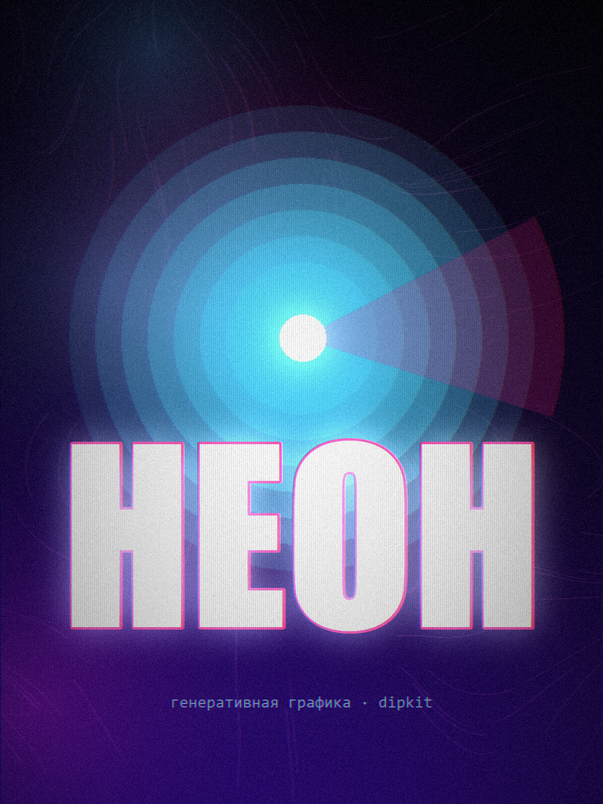

# ДИПСИК ХУДОЖНИК

DeepSeek рисует картинки — **кодом**. Ты просишь словами, модель пишет короткий
Python-скрипт, локальный движок `dipkit` рендерит настоящий PNG.

Никакой диффузии, никакого GPU, никакого API-ключа: картина — это программа,
поэтому она воспроизводима и правится в одну строку.

```
«нарисуй постер про осень»  ->  work.py  ->  dipkit  ->  art.png
```



## Честно о границах

DeepSeek — текстовая модель, пиксели она не выдаёт. Поэтому «Художник» работает так:

| Подход | Кто рисует | Что получается |
|---|---|---|
| **этот проект** | код, который пишет модель | постеры, обложки, логотипы, абстракция, пиксель-арт, генеративная графика |
| диффузионная модель | Stable Diffusion / Flux / Kandinsky | фотореализм, портреты, сложные текстуры |

Фотореализм кодо-арт не даёт — это не баг, а природа подхода. Зато здесь есть то,
чего нет у диффузии: **результат детерминирован** (тот же seed — та же картинка),
**бесплатно правится** («сделай темнее» = правка константы, а не новая генерация)
и **объясним** — каждая линия имеет причину.

Диффузию можно подключить как второй бэкенд: движок к этому готов, см.
«Куда развивать» ниже.

## Быстрый старт

```powershell
# 1. Проверить окружение
.\dip.cmd doctor

# 2. Посмотреть стили
.\dip.cmd styles

# 3. Нарисовать
.\dip.cmd new "закат над морем, минимализм" --style gradient-poster

# 4. Что получилось
.\dip.cmd ls
.\dip.cmd gallery
```

Работа складывается в `art/works/<дата>-<слаг>/`:

```
art/works/2026-10-09-193604-zakat-nad-morem/
├── work.py        # исходный код картины — её можно править и перерисовать
├── art.png        # результат
├── art.thumb.png  # миниатюра
└── meta.json      # промпт, стиль, seed, время, ошибки
```

## Рисование из чата (скилл)

Проект содержит скилл DSH — `.dsh/skills/dipseek-artist/SKILL.md`. Он подхватывается
автоматически и без перезапуска. После этого достаточно попросить словами:

> нарисуй минималистичный постер про горы, цвета — приглушённые

Агент сам выберет стиль, прочитает рецепт, напишет `work.py`, отрисует и покажет PNG.
Правки — тоже словами: «сделай темнее и убери текст».

## Приложение для Android

То же самое, но на телефоне: пишешь запрос — DeepSeek пишет код — **Python-движок
рисует PNG прямо на устройстве**. Без серверов и без ПК.

Как это устроено: [Chaquopy](https://github.com/chaquo/chaquopy) кладёт CPython
внутрь APK, поэтому `python/` уходит в приложение как есть — отдельной версии
движка для телефона не существует. Портировать пришлось только три вещи: пути
(`os.environ["HOME"]` вместо папки проекта), шрифты (`/system/fonts`, Roboto вместо
Segoe/Impact) и запуск кода (на Android нет подпроцессов, поэтому `exec()` в
демон-потоке с таймаутом вместо `subprocess`).

Собрать APK можно двумя путями:

```powershell
# 1. Локально, одной командой: скрипт сам найдёт Java, Python 3.12, SDK и Gradle
powershell -ExecutionPolicy Bypass -File .\build-apk.ps1
powershell -ExecutionPolicy Bypass -File .\build-apk.ps1 -DryRun   # только показать план
```

2. **В GitHub Actions** — если не хочется ничего ставить: залей репозиторий,
   запусти workflow «Сборка APK», скачай артефакт.

```powershell
.\dip.cmd checkandroid   # проверить проект без сборки
.\dip.cmd icons          # перерисовать иконку приложения
```

Пошаговая инструкция, разбор версий (почему Python 3.12 и `minSdk` 24), ограничения
и таблица типовых ошибок — в [android/README.md](android/README.md).

Два момента, которые стоит знать сразу:

- **Ключ DeepSeek вводит пользователь** в настройках приложения, он хранится в
  шифрованном виде на устройстве. Вшивать ключ в APK нельзя: APK — это zip,
  и любую строку оттуда достанет кто угодно.
- **Интернет обязателен.** Рисует телефон, но код пишет DeepSeek в облаке.

## Команды

| Команда | Что делает |
|---|---|
| `.\dip.cmd styles [имя]` | список стилей или рецепт одного |
| `.\dip.cmd api [--full]` | справочник API движка для художника |
| `.\dip.cmd new "<текст>" -s <стиль>` | создать и отрисовать работу |
| `.\dip.cmd new "<текст>" --code code.py` | взять готовый код вместо DeepSeek |
| `.\dip.cmd init "<текст>" -s <стиль>` | только создать папку работы |
| `.\dip.cmd render <папка> --prompt "..." --style ...` | отрисовать `work.py` |
| `.\dip.cmd revise <работа> "что поправить"` | попросить DeepSeek исправить |
| `.\dip.cmd show [имя] [--meta]` | путь к PNG работы |
| `.\dip.cmd ls` | список работ |
| `.\dip.cmd gallery` | контактный лист всех работ |
| `.\dip.cmd doctor` | проверка окружения |
| `.\dip.cmd selftest` | 53 проверки движка (включая путь Android) |
| `.\dip.cmd mobiletest` | 13 проверок моста, через который говорит приложение |
| `.\dip.cmd simandroid` | прогон движка в режиме Android (HOME, exec, кириллица) |
| `.\dip.cmd checkandroid` | статическая проверка Android-проекта без сборки |
| `.\dip.cmd icons` | нарисовать иконку приложения движком |
| `.\dip.cmd clean` | убрать кэш и служебные папки (перед сборкой APK) |

Полезные ключи: `--size 1600x900` (или пресеты `poster`, `square`, `wide`, `story`,
`card`, `avatar`, `wallpaper`), `--seed 42` (повторяемость), `--timeout 300`.

## Подключение DeepSeek API (необязательно)

Без ключа рисует агент в чате — этого достаточно. Ключ нужен, только если хочешь
**автономный CLI**, который сам зовёт модель:

```powershell
Copy-Item .env.example .env
# открой .env и вставь ключ с https://platform.deepseek.com
.\dip.cmd new "плакат про космос" --style neon-glow
```

Либо через переменную окружения: `$env:DEEPSEEK_API_KEY = "sk-..."`.

## Стили

`gradient-poster`, `minimal-geometry`, `risograph`, `blueprint`, `neon-glow`,
`flow-field`, `pixel-scene`, `paper-collage`, `starry-night`, `bauhaus`, `organic-flow`.

Стиль — это не только палитра, а **рецепт**: какие приёмы делают его узнаваемым и
чего избегать. Рецепты лежат в `dipkit/styles.py` и читаются художником до работы.
Добавить свой стиль — дописать один словарь.

## Устройство

```
ДИПСИК ХУДОЖНИК/
├── dip.py                  # CLI
├── dip.cmd                 # лаунчер: сам находит нужный Python
├── build-apk.ps1           # сборка APK одной командой (сам ставит SDK и Gradle)
├── python/                 # ОДИН движок для ПК и для Android
│   ├── mobile.py           # JSON-мост, через который говорит приложение
│   └── dipkit/
│       ├── canvas.py       # ArtCanvas + Layer: градиенты, шум, фигуры, текст, эффекты
│       ├── styles.py       # 11 стилей с рецептами и палитрами
│       ├── runner.py       # запуск work.py: subprocess на ПК, exec на Android
│       ├── gallery.py      # индекс работ и контактный лист
│       ├── brain.py        # DeepSeek API + системный промпт художника
│       └── paths.py        # где что лежит на ПК и на Android
├── android/                # приложение: Kotlin + Compose + Chaquopy
│   ├── app/src/main/java/com/dipseek/artist/
│   └── README.md           # как собрать APK
├── tools/                  # selftest, тест моста, иконки, статические проверки
├── .dsh/skills/dipseek-artist/SKILL.md
├── .github/workflows/android-apk.yml
└── art/works/              # картины: код + PNG + метаданные
```

Движок лежит в `python/` не случайно: эту папку целиком забирает Chaquopy,
собирая APK, — так приложение и ПК используют один и тот же код без копий.

Ключевые решения:

- **`_Painter`** — общая логика рисования; и холст, и слой наследуют её, поэтому
  **любой** примитив и **любой** эффект доступны в обоих режимах.
- **float32-пиксели** в 0..1, а не uint8 — градиенты не полосатые, эффекты считаются
  без потери точности, квантование делается один раз в самом конце.
- **Premultiplied alpha** на слоях — корректный композитинг без ореолов.
- **Работа = папка с кодом.** Картина воспроизводима, диффится и версионируется.

## Пример картины

```python
import os, sys
sys.path.insert(0, os.path.abspath(os.path.join(os.path.dirname(__file__), "..", "..", "..")))
from dipkit import ArtCanvas

SEED = 20240501
W, H = 1200, 1600
OUT = os.path.join(os.path.dirname(os.path.abspath(__file__)), "art.png")

c = ArtCanvas(W, H, bg="#05010f", palette="neon")
c.meta = {"prompt": "неоновый город", "style": "neon-glow", "seed": SEED}

c.gradient(["#05010f", "#3a0ca3"], angle=100)
c.blobs(5, ["#f72585", "#4cc9f0"], r=(0.25 * W, 0.6 * W), alpha=0.30, seed=SEED)
c.flow(["#4cc9f0", "#f72585"], lines=120, steps=90, alpha=0.25, seed=SEED)
c.text_fit("НЕОН", max_width=0.8, y=int(0.09 * H), family="sans-bold",
           color="#e0fbfc", stroke=3)
c.bloom(0.62, 34, 0.7).scanlines(4, 0.12).vignette(0.5).grain(0.035, seed=SEED)
c.save(OUT)
```

## Куда развивать

1. **Свой стиль** — дописать словарь в `dipkit/styles.py`.
2. **Новые примитивы** — метод в `_Painter`, и он сразу доступен холсту и слоям.
3. **Диффузионный бэкенд** — модуль `dipkit/backends/sd.py`: `brain.plan_work` уже
   умеет писать промпты, остаётся отправить их в ComfyUI (`127.0.0.1:8188`),
   AUTOMATIC1111 (`/sdapi/v1/txt2img`) или Kandinsky. Тогда фотореализм тоже станет
   доступен — как отдельный стиль рядом с кодо-артом.
4. **Vision-критик** — `deepseek-chat` слепой и не видит свою картинку. Модуль с
   моделью, умеющей смотреть, замкнул бы цикл «нарисовал → оценил → исправил».
5. **Веб-галерея** — `gallery.contact_sheet` уже собирает лист; сверху легко
   положить страницу с историей и кнопкой «перерисовать с другим seed».
6. **Приложение** — `mobile.py` уже умеет `works`, `work_code`, `delete_work` и
   `render` произвольного кода; в интерфейсе пока не хватает редактирования кода
   и удаления работ.

## Требования

- Windows с Python 3.10+ (проект проверен на bundled-рантайме DSH 3.12.14)
- `Pillow` и `numpy` — уже есть в рантайме DSH; вне его: `pip install -r requirements.txt`
- Шрифты Windows (Segoe UI, Consolas, Georgia, Impact) — используются автоматически;
  на Android движок сам переключается на Roboto и Noto из `/system/fonts`

Для сборки APK (не для рисования) нужны Java 17, Android SDK 35 и Python 3.12 —
либо ничего из этого, если собирать в GitHub Actions.

Свой интерпретатор задаётся переменной `DIP_PYTHON`:
```powershell
$env:DIP_PYTHON = "C:\Python312\python.exe"; .\dip.cmd doctor
```
